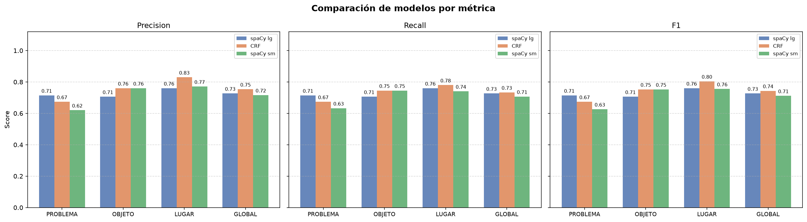
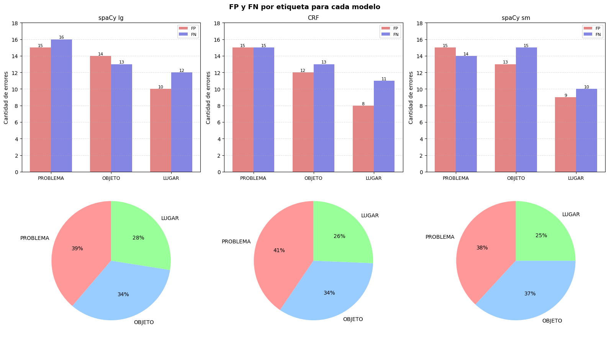

# Proyecto de Procesamiento de Lenguaje Natural

**Trabajo Práctico Final de la materia Procesamiento de Lenguaje Natural - Universidad de Palermo.**

## Integrantes

- Juan Cruz Rey
- Juan Ignacio Pintarelli
- Paula Goldenhorn

## Objetivos

El objetivo del trabajo es entrenar y evaluar modelos de Reconocimiento de Entidades Nombradas (NER) para extraer automáticamente información estructurada sobre incidentes en aulas y entornos educativos. A partir de ejemplos de mensajes de docentes en lenguaje natural, los modelos identifican las siguientes entidades:

- **OBJETO**: Elemento físico afectado.
- **PROBLEMA**: Falla o incidente reportado.
- **LUGAR**: Ubicación del incidente.

## Dataset

Se construyó un dataset sintético de ejemplos 570 anotados manualmente y aumentados con herramientas de IA. Se dividió en conjuntos de entrenamiento (80%), desarrollo (10%) y validación (10%).

## Modelado

Se entrenaron tres modelos para comparar dos enfoques: entrenamiento desde cero vs. aprendizaje por transferencia:
- **Fine-tuning spaCy (`es_core_news_lg`):** modelo neuronal de spaCy versión grande en español (con embeddings estáticos preentrenados).
- **Fine-tuning spaCy (`es_core_news_sm`):** modelo neuronal de spaCy versión pequeña en español (sin embeddings preentrenados).
- **Entrenamiento CRF**: modelo probabilístico de Campos Aleatorios Condicionales de scikit-learn.

## Resultados

**Métricas globales**

| Modelo | Precisión | Recall  | F1 |
| --- | --- | --- | --- |
| spaCy lg | 0.7267 | 0.7267 | 0.7267 |
| CRF | 0.7534 | 0.7333 | 0.7432 |
| spaCy sm | 0.7162 | 0.7067 | 0.7114 |

**Métricas por tipo de entidad**



**Distribución de errores (falsos positivos y falsos negativos)**



## Estructura del repositorio

```
├── NOTEBOOK.ipynb                  # Notebook principal (pipeline del proyecto)
├── INFORME.pdf                     # Informe del proyecto
├── config/                         # Archivos de configuración de spaCy
├── data/                           # Dataset y datos en formato binario spaCy
│   ├── dataset_limpio.jsonl        # Dataset anotado (entrada del notebook)
│   └── train/dev/val.spacy         # Splits generados por el notebook
├── output/                         # Salidas del notebook
│   └── images/                     # Gráficos generados por el notebook
│       ├── balance_clases.png          # Balance de clases del dataset
│       ├── crf_max_iterations.png      # Búsqueda de max_iterations del CRF
│       ├── comparacion_metricas.png    # Comparación de métricas entre modelos
│       └── distribucion_errores.png    # Distribución de FP y FN por etiqueta
│   ├── model-best/                 # Mejor modelo spaCy es_core_news_lg. Se genera al ejecutar el Notebook.
│   └── model-last/                 # Último checkpoint spaCy es_core_news_lg. Se genera al ejecutar el Notebook.
└── output_small/                   # model-best/ y model-last/ de spaCy es_core_news_sm. Se generan al ejecutar el Notebook. 
```
